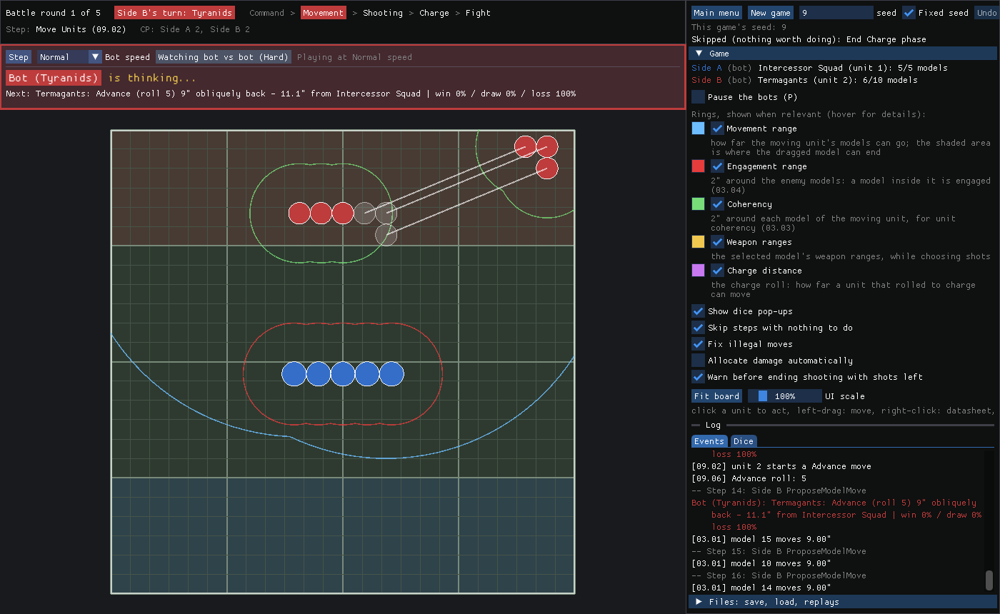

# VibeHammer

A Warhammer 40,000 (11th edition) skirmish for Windows. It is a deterministic C++20 rules engine with a 2D
top-down client that follows the core rules, played hotseat or against a bot.

The default scenario is **Incursion objectives** (`incursion_objectives_44x60.json`), two armies on a 44" x 60"
portrait battlefield:
- **The armies.** The Chaos Space Marines field a Chaos Lord, two squads of Legionaries, Chaos Terminators and
  Havocs. The Tyranids field a Hive Tyrant, Termagants, Genestealers, Tyrant Guard, two Screamer-killers and a
  Tyrannofex.
- **The objectives.** There are three: a 12" Centre and a 6" home area for each side. At the end of every phase and
  turn, the side with more Objective Control (OC) in an area controls it.
- **Scoring.** From battle round 2, each side scores in its own Command phase for the areas it controls:
  - the Centre, 1 VP;
  - its own home, 4 VP;
  - the enemy's home, 8 VP.

  After battle round 5 each side also scores 1 VP per 25 points it has destroyed.
- **Winning.** Wiping the other side out still wins. Otherwise the most VP wins, and points destroyed settle a tie.

The start screen's Scenario list has the other scenarios:
- **V1 skirmish** (`v1_skirmish.json`): one unit each on a 24" x 24" board.
- **Strike** (`strike_44x60.json`): three Intercessor Squads against four units of Termagants on a full-size
  60" x 44" battlefield.
- **Incursion** (`rosters_44x60.json`): the same armies with no objectives. The side that destroyed more points
  wins.

A **custom battle** plays the objective mission with armies you build yourself, set up automatically or by hand.

On the board, each unit has its own shade of its side's colour and a number.



## Download and play

Get `VibeHammer-vX.Y.Z-windows-x64.zip` from the [Releases](https://github.com/Joeb1603/VibeHammer/releases)
page, unzip the whole folder and run `VibeHammer.exe`. If SmartScreen warns you, click "More info" and then
"Run anyway". The start screen offers these modes:

- **Play hotseat:** two players share the computer.
- **Play vs bot:** you choose your side.
- **Watch bot vs bot**, with Pause (key P), Step (key N) and the bot speed.
- **Custom battle...:** the army builder (below). Each side builds an army, then you play hotseat, against
  the bot or bot vs bot.
- **Continue saved game** or **Watch a replay**.

Follow the decision panel at the top of the screen. Click the board to pick units, targets and casualties,
and drag models to move them. While you drag a model on an oval base (the Tyrannofex), Q and E turn it 15°
and Shift+mouse wheel turns it 5°. Every roll shows in a dice pop-up. The event log cites the rule number
behind each step.

## What's implemented

- **The full turn:** the Command, Movement, Shooting, Charge and Fight phases and end of turn, over five
  battle rounds. This includes battle-shock, the attack sequence (hit, wound, save, damage), allocation
  groups, and pile-in and consolidation.
- **Geometry:** distances are measured edge to edge between bases, with 2" Engagement Range and unit
  coherency. Moves are checked along their whole path, not only where they end. Oval bases have a facing
  and can turn as they move.
- **Weapon abilities:** Assault, Heavy, Pistol, Rapid Fire, Blast, Torrent, Hazardous, Sustained Hits,
  Extra Attacks and Twin-linked. Twin-linked asks which wound rolls to re-roll when one fails. Random
  Damage (D6, D6+1, ...) and random Attacks on ranged weapons are rolled as the attack resolves. A weapon
  with an ability that isn't implemented yet (Lethal Hits, Devastating Wounds, Anti, Melta, ...) can't be
  selected.
- **Monsters and vehicles:** they can move through enemy infantry. They can also shoot, and be shot at,
  while in Engagement Range.
- **The bot** (`src/ai`) plays only through the same validated actions a human uses, and it never sees the
  game's future dice. It plans its shooting, charges, fights and moves from the odds. (Until M85 there were three
  levels, Easy, Normal and Hard; the one bot is Normal. The others are in git under the tag `bots-three-levels`.)
- **Custom battles:** an army builder for Chaos Space Marines against Tyranids at Incursion size (1000
  points) on the 44" x 60" battlefield. Points by unit size and wargear, unit sizes, wargear options and
  their limits, and copy limits come from BSData and are enforced; every army needs a CHARACTER. Options
  with a weapon the engine can't play yet are greyed out with the reason. Lists can be saved and loaded,
  and you choose who takes the first turn.
- **Deployment:** "Auto-place" sets both armies up in their zones. "Place by hand" has the sides take turns
  setting up one unit at a time (the side taking the second turn first), each set-up checked against the
  core rules (in the zone, coherent, not on another model, out of Engagement Range). Drag a unit to place it,
  Shift-drag one model, and turn an oval with Q / E. The bot sets its own units up: long-range shooters first
  and back, melee units last and forward.
- **Replays and saves:** a replay is the starting state plus every action, and it reproduces the game
  exactly. The saved replays in `tests/replays/` double as regression tests.

- **Several units per side:** every phase handles any number of units, and the bot plans across its whole army.
  On the Incursion scenario it weighs units by their points and plays for the points result.
  - **Teamwork:** the bot fights as an army. Each turn an army plan looks for enemy units that two or three
    of its units beat together where each alone would lose, and puts them in a group on that target. The group
    moves up together, waiting at the edge of the target's reach for its slower members. Its units shoot the
    group's target first and finish off wounded units rather than spread their fire, and a unit charges in where a
    partner is already fighting. With one unit a side nothing changes.
  - **Objectives:** on a mission the bot plays for the areas. Its army plan sends the units that no group needs to
    hold, take or contest an area, choosing the cheapest units with enough OC. Moves count the VP they deny the enemy
    at the end of the bot's turn and the VP they hold through the enemy's turn.

**Not yet:** terrain, missions beyond the one objective mission, stratagems, unit abilities (including
Leader, Feel No Pain and Deadly Demise), the weapon abilities listed above as refused, and other unit types.
`PLAN.md` lists what comes next.

## Building from source

The build needs CMake 3.28 or newer and a C++20 compiler. CMake's `FetchContent` downloads the dependencies,
each pinned to an exact tag: raylib, Dear ImGui, rlImGui, nlohmann_json and GoogleTest.

**Windows** (Visual Studio 2026, using the presets):

```powershell
cmake --preset default
cmake --build --preset debug
ctest --preset debug
.\build\default\src\client_2d\Debug\wh40k_client_2d.exe
```

**Linux** (Ninja and GCC). raylib needs the X11 and GL development packages (libxrandr, libxinerama,
libxcursor, libxi and libgl1-mesa):

```bash
cmake -S . -B build/linux -G Ninja -DCMAKE_BUILD_TYPE=Debug
cmake --build build/linux && (cd build/linux && ctest)
```

To package the game, run `powershell -ExecutionPolicy Bypass -File tools\package.ps1` on Windows. It writes
`VibeHammer.zip`. To publish a release, set the version in `CMakeLists.txt` and `src/core/version.cpp`,
add `docs/releases/vX.Y.Z.md`, and push the tag `vX.Y.Z`. The Release workflow then builds the zip, tests
it and publishes it.

## Repository layout

| Path | What it is |
|---|---|
| `src/core/` | `wh40k_core`: the headless rules engine (standard library and nlohmann_json only) |
| `src/client_2d/` | the raylib and Dear ImGui client; `logic/` holds its raylib-free code |
| `src/ai/` | `wh40k_ai`: the bot, plus `wh40k_bot_arena` for bot vs bot statistics |
| `tests/` | GoogleTest suites for core, client logic and the bot, plus the saved replays |
| `data/units/`, `data/scenarios/` | unit datasheets generated from BSData, and the scenarios |
| `data/factions.json`, `data/armies/` | the custom battles' factions and their stock army lists |
| `docs/decisions.md`, `docs/decisions/` | index of the rule interpretations and design decisions (D-001 ...), one file each, cited in code |
| `docs/rules/` | the core rules text the engine follows (private; see below) |
| `docs/datasheets/` | the two army rosters behind the Incursion scenario (private; see below) |
| `docs/dev/` | developer reference: replays, client flags, the bot arena, packaging and data regeneration |
| `PLAN.md`, `docs/plan_archive.md` | the milestone plan (current and upcoming), and the finished milestones |
| `CLAUDE.md` | the architecture and conventions |

## Rules text and copyright

Warhammer 40,000 and its rules are © Games Workshop. VibeHammer is an unofficial fan project and is not
endorsed by Games Workshop. `docs/rules/` and `docs/datasheets/` hold Games Workshop's copyrighted text and
are committed only because this repository is private. Never publish them, and never include them in a
release. The scenario files keep only each unit's points and loadout.
